# Parla

**An AI speaking tutor for iOS and Android. You talk, on-device speech recognition transcribes you, and a tutor replies, corrects you and keeps the conversation going. Every word gets pronunciation feedback, mistakes come back for spaced review, and a StoreKit 2 subscription unlocks unlimited practice.**

[](https://github.com/OwaisMunawar/parla/actions/workflows/ci.yml)
[](https://docs.expo.dev/versions/v57.0.0/)
[](https://reactnative.dev)
[](LICENSE)

<p align="center">
  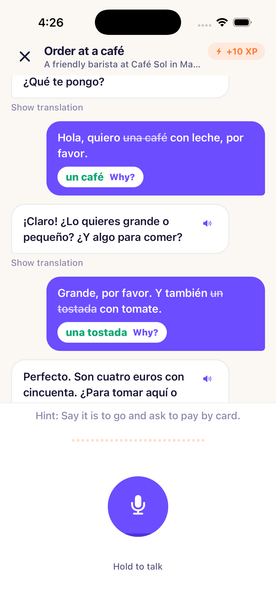
  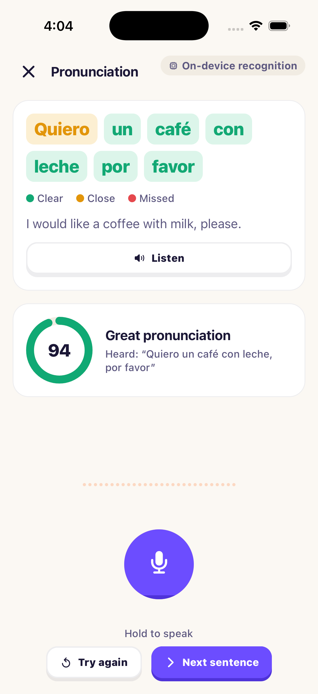
  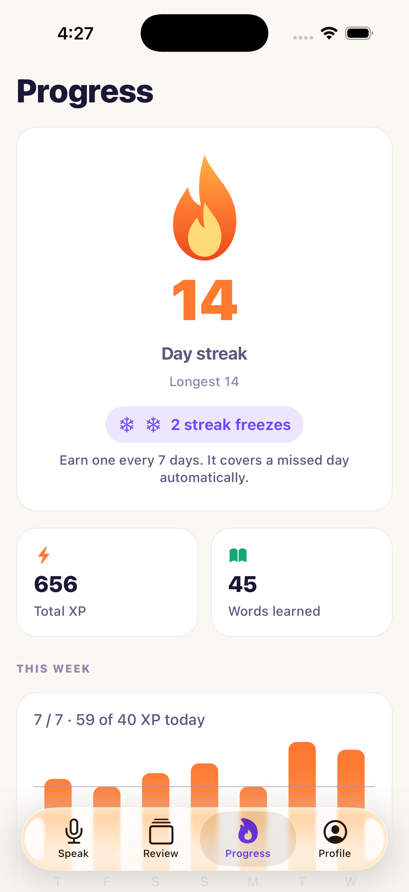
  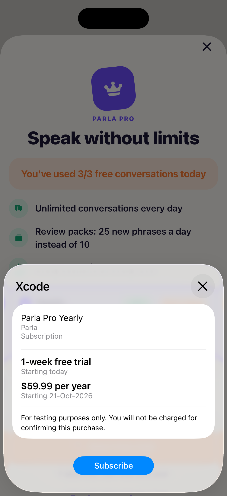
</p>

<p align="center">
  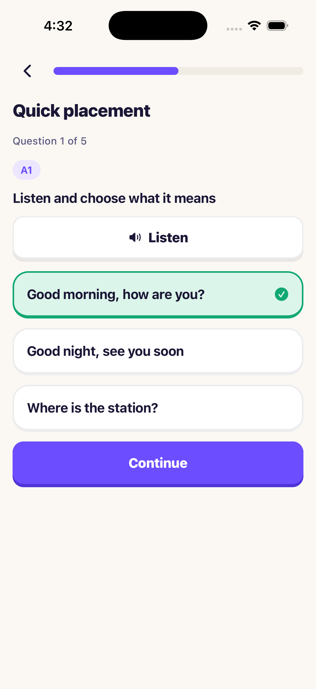
  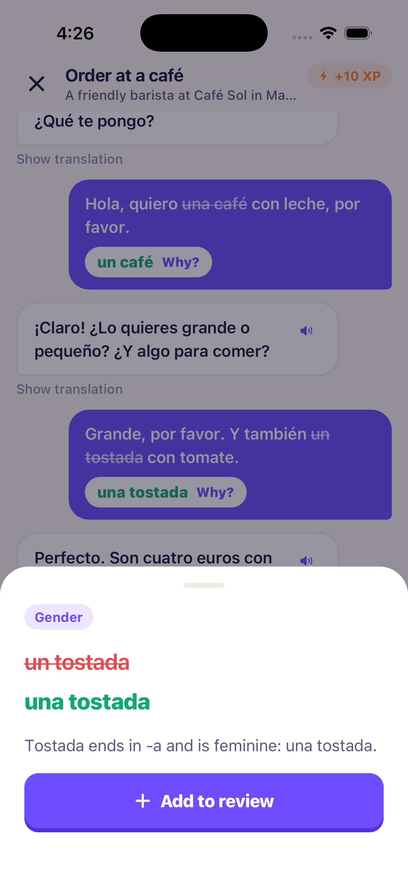
  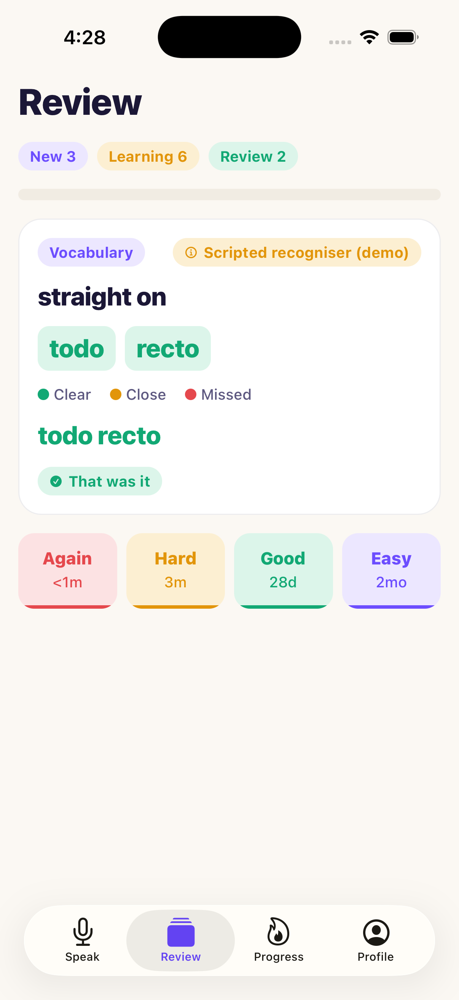
  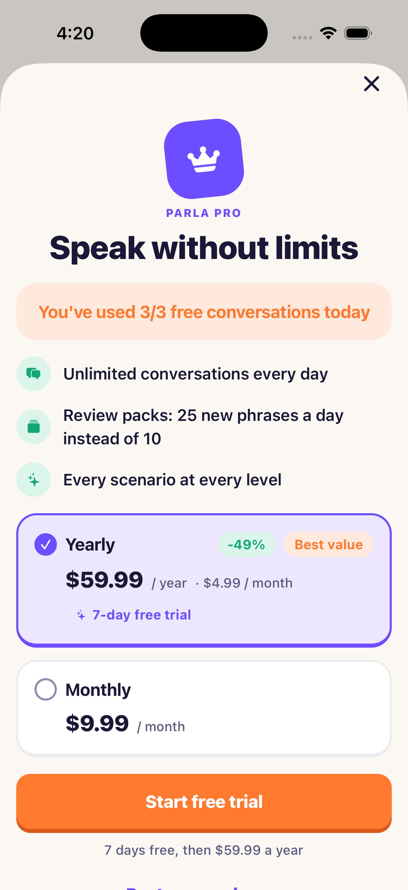
  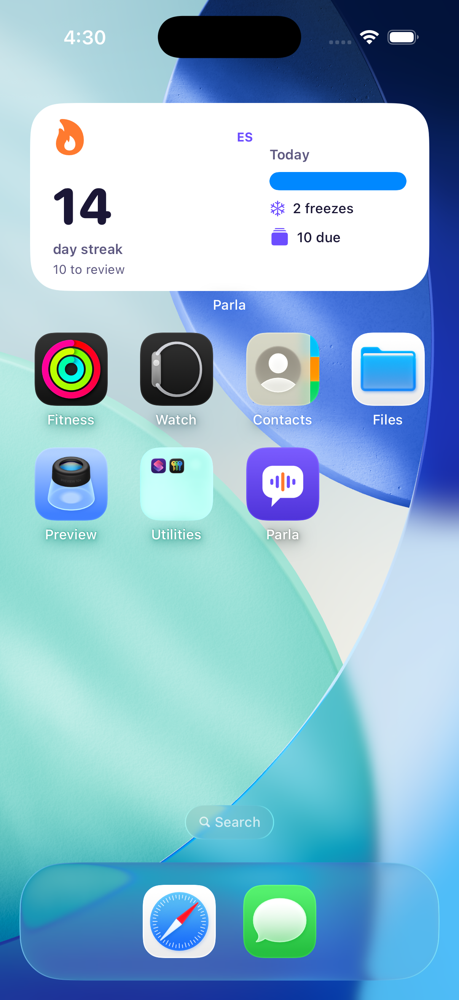
</p>

<p align="center">
  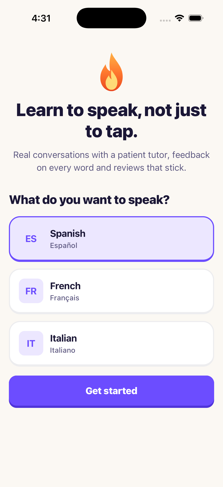
  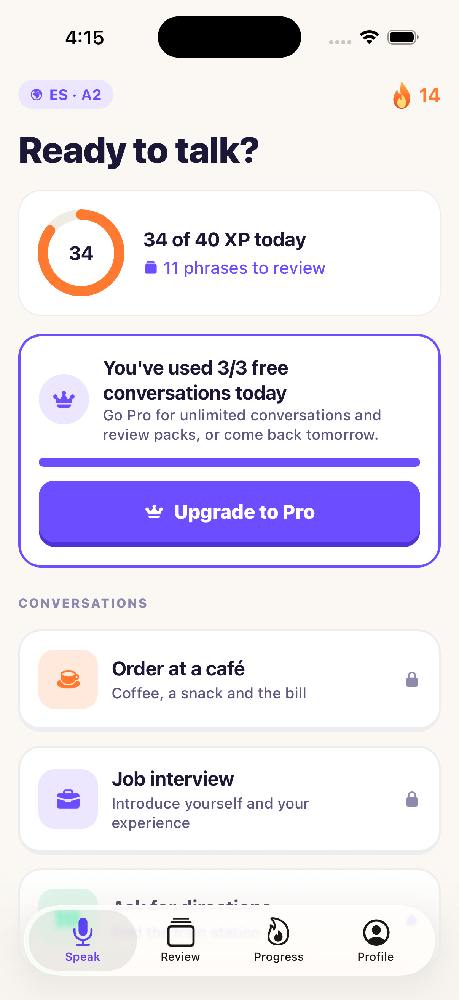
  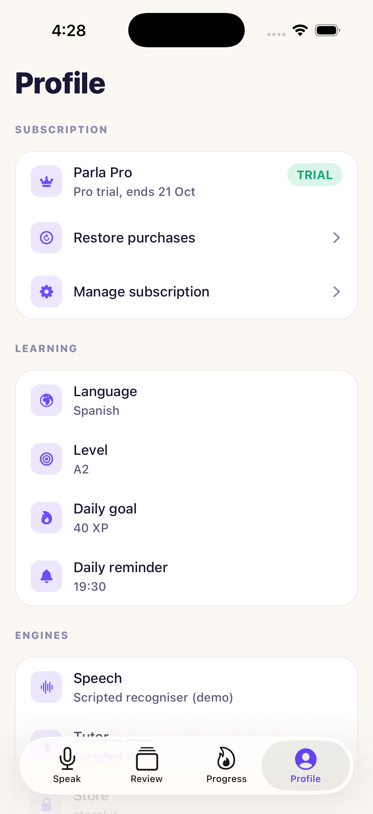
  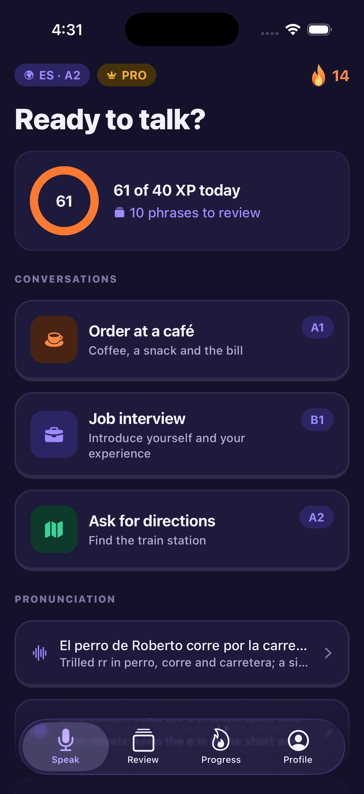
</p>

<sub>Real captures from an iPhone 17 Pro simulator (iOS 26.5) running the demo build. The learner is fictional. The drill used Apple's on-device recogniser on a bundled audio clip; the conversation and review captures show the scripted recogniser, labelled as such in the app, because the simulator's recogniser fails to start once text to speech has used the audio session. The purchase is a local StoreKit test transaction: nobody was charged.</sub>

## Why

Speaking is the skill language apps teach least. Most of them are tap-the-right-tile games: they build recognition, not production, and learners who finish a 300-day streak still freeze when a waiter asks them something. The fix is unglamorous: say a lot of sentences out loud, to someone who answers, and get told precisely what was wrong.

Parla is built around that loop:

- **Talk first.** Every screen that teaches has a hold-to-talk button. Placement, conversations, drills and even review answers are spoken.
- **Corrections in place.** A mistake is struck through in your own sentence with the fix beside it; tap it for the rule, then send it to review.
- **Mistakes come back.** Saved corrections and new vocabulary are scheduled with FSRS, so the phrase you got wrong on Monday returns before you forget it.
- **Honest feedback.** Pronunciation scores say what the recogniser heard, word by word, and the app always shows which recogniser and which tutor produced a result.

## Features

- **Onboarding** with a five-question placement (listening and speaking, A1 to B2) that sets a CEFR starting level, a daily XP goal, a reminder time and a soft paywall with "maybe later".
- **Conversation practice** in Spanish, French and Italian: order at a café, a job interview, asking for directions. Hold to talk with a live waveform and interim transcript; the tutor answers out loud with per-language voices, and every line has a translation on tap.
- **Pronunciation drills** that colour each word as clear, close or missed, with what was actually heard and a retry.
- **Review** with due counts, again/hard/good/easy, interval previews on every button, and listen-and-speak answers scored by the same aligner.
- **Progress**: streak with freeze tokens, total XP, a weekly chart against the daily goal, words learned and progress to the next CEFR band.
- **Subscription**: monthly and yearly plans with a free trial on yearly, a "you've used 3/3 today" upsell, restore, manage subscription, and the entitlement reflected on home, review limits and the profile.
- **Home-screen streak widget** on iOS and a daily reminder whose copy names the streak at stake.
- **Demo mode** (`EXPO_PUBLIC_DEMO=1`): a fictional learner with a 14-day streak, review cards and history, the scripted tutor, and bundled clips fed to the recogniser for every Spanish speaking prompt.

## Architecture

Feature-first: `src/features/{onboarding,conversation,pronunciation,review,progress,billing,widget}` own their screens, hooks, data access and pure logic; `src/core` holds the database driver, theme and UI primitives, i18n, speech engines and typed errors; `src/app` is thin Expo Router routes. Everything with a platform behind it (`Tutor`, `SpeechRecognizer`, `Speaker`, `Billing`, `Clock`, reminders, the widget) is an interface with a real and a fake implementation, assembled once in [`src/composition`](src/composition) and passed down through a provider. Domain code under `lib/` imports neither React nor Expo, which ESLint enforces.

### One spoken turn

```mermaid
flowchart LR
  mic[Hold to talk] --> rec{SpeechRecognizer}
  rec -->|on device where supported| sf[SFSpeechRecognizer / Android SpeechRecognizer]
  rec -->|demo on a simulator| clip[Bundled clip as audio file input]
  rec -->|no recogniser| scripted[Scripted recogniser, labelled]
  sf --> transcript[Transcript + segments + confidence]
  clip --> sf
  scripted --> transcript
  transcript --> tutor{Tutor}
  tutor -->|no key, no network| script[Scripted tutor]
  tutor -->|EXPO_PUBLIC_TUTOR_URL| server[server/ · AI SDK structured output · NDJSON stream]
  script --> reply[Reply + corrections + vocabulary + CEFR estimate]
  server --> reply
  reply --> ui[Inline corrections + TTS reply]
  reply --> xp[XP, streak, level]
  ui -->|Add to review| fsrs[FSRS card in SQLite]
  fsrs --> review[Review queue]
```

The tutor turn has one zod schema, [`tutorContract.ts`](src/features/conversation/lib/tutorContract.ts), shared by the server (which asks the model for exactly that shape) and the app (which validates it again on arrival). The server drops any correction whose `original` is not literally in what the learner said, so a hallucinated fix can never point at the wrong words.

### Entitlement state machine

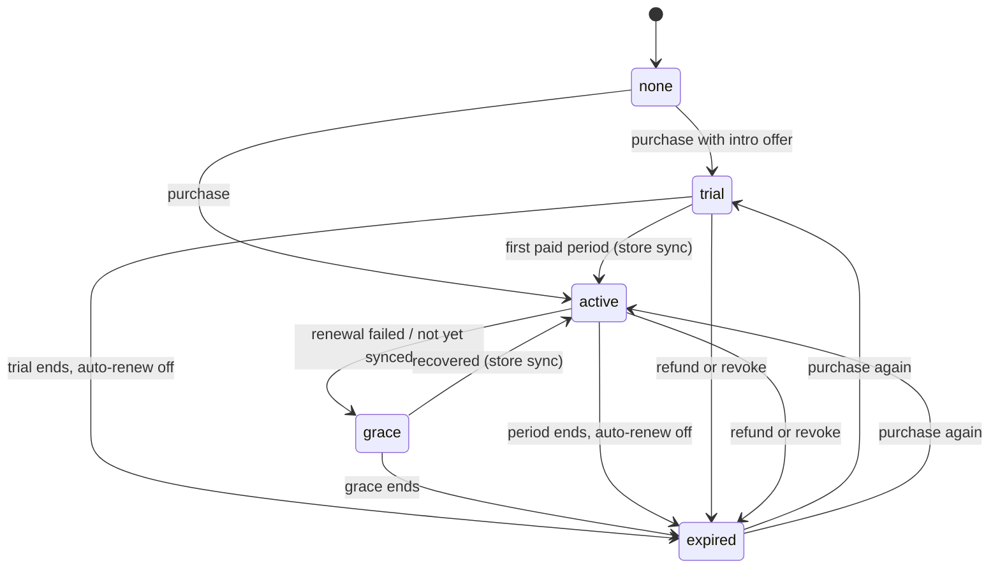

[`entitlement.ts`](src/features/billing/lib/entitlement.ts) is pure and tested edge by edge. The store is the source of truth: every launch and foreground re-syncs, and the machine only decides what the app shows between syncs, including keeping access for a short window when a renewing period ends offline.

## How pronunciation scoring works

1. The learner says the target sentence. The sentence is also passed to the recogniser as a contextual string: biasing towards what they are trying to say is fair, because a word the recogniser still mishears is one a listener would struggle with too.
2. Both sides are tokenised the same way: edge punctuation dropped (¿Dónde? and dónde are one word), elisions kept as one token (l'eau, j'ai, un'altra), and a diacritic-free form kept alongside the exact one.
3. A word-level Levenshtein alignment pairs target words with heard words. Substituting a similar word ("gracia" for "gracias") costs less than an unrelated one, so when a learner both drops a word and mispronounces its neighbour, the feedback lands on the right words. Ties prefer the diagonal, so one wrong word reads as one substitution rather than a miss plus an extra.
4. Each target word is scored: a match is shaded by the segment's confidence (iOS gives per-segment confidence; where the platform reports none, the score does not pretend), an accent-only difference counts as close, a near-miss scores by character similarity, a missed word scores zero. Extra words cost a little overall.
5. Words are coloured clear, close or missed, and the overall score is the mean.

This measures intelligibility, not phoneme accuracy. It needs no model download, works offline and costs nothing per attempt, and [`alignment.ts`](src/features/pronunciation/lib/alignment.ts) and [`score.ts`](src/features/pronunciation/lib/score.ts) are pure and fully tested. Phoneme-level scoring is on the roadmap.

## Monetisation

|                                  | Free    | Pro               |
| -------------------------------- | ------- | ----------------- |
| Conversations                    | 3 a day | Unlimited         |
| New review cards a day           | 10      | 25 (review packs) |
| Drills, review, progress, widget | Yes     | Yes               |

- **Products**: `com.owaismunawar.parla.pro.yearly` ($59.99, one-week free trial) and `com.owaismunawar.parla.pro.monthly` ($9.99), one subscription group. A conversation counts once you have spoken in it, never when the screen opens, so browsing scenarios does not burn a slot.
- **StoreKit 2 / Play Billing** through [expo-iap](https://github.com/hyochan/expo-iap) behind the [`Billing`](src/features/billing/engine/Billing.ts) interface. Prices, currency and trial length come from the store; the app formats nothing it can read from it.
- **Local StoreKit testing**: [`store/Parla.storekit`](store/Parla.storekit) defines both plans and the trial. A config plugin ([`plugins/withStoreKitConfig.js`](plugins/withStoreKitConfig.js)) copies it into `ios/` and references it from the scheme's Run action on every prebuild, so CNG never loses it.
- **RevenueCat (optional)**: [`revenueCatBilling.ts`](src/features/billing/engine/revenueCatBilling.ts) implements the same interface over `react-native-purchases` and maps the `pro` entitlement. To use it, move `react-native-purchases` from devDependencies to dependencies, remove it from `expo.autolinking.exclude` in `package.json`, and set `EXPO_PUBLIC_BILLING_PROVIDER=revenuecat` with your public SDK keys.

### Testing purchases locally

1. `npx expo prebuild --platform ios` and open `ios/Parla.xcworkspace` in Xcode.
2. Select a simulator and press Run. The scheme already points at `Parla.storekit`, so the paywall loads both plans and the purchase sheet completes without an App Store Connect account.
3. Use **Debug → StoreKit → Manage Transactions** to refund, expire or speed up renewals and watch the entitlement move through trial, active, grace and expired.

StoreKit testing only accepts a build that carries the `get-task-allow` entitlement, which any development-signed build has. An unsigned simulator build is refused by storekitd with "not installed for development"; select your own team in Signing & Capabilities for local runs. Nothing in the repo carries a team ID. The screenshots above were taken this way, with the configuration loaded through a StoreKitTest session hosted in the running app.

## Tech stack

| Area     | Choice                                                                                                                                                                          |
| -------- | ------------------------------------------------------------------------------------------------------------------------------------------------------------------------------- |
| App      | Expo SDK 57 (development build), React Native 0.86, React 19.2, Expo Router, React Compiler, TypeScript strict                                                                  |
| Speech   | `expo-speech-recognition` (on-device when available, interim results, segments, audio file input), `expo-speech` with per-language voice selection                              |
| Tutor    | Scripted tutor in the app; `server/` on Node with AI SDK 7 `streamText` + `Output.object` and zod, any provider via env (AI Gateway model ids or an OpenAI-compatible endpoint) |
| Payments | `expo-iap` 6 (StoreKit 2, Play Billing), optional `react-native-purchases` adapter, local `.storekit` configuration                                                             |
| Learning | `ts-fsrs` (FSRS) behind a storage-shaped wrapper; word-level alignment scoring                                                                                                  |
| UI       | Reanimated 4, `@shopify/react-native-skia` (progress rings, streak flame, weekly chart, confetti), expo-haptics, design tokens with light and dark themes                       |
| Platform | `expo-widgets` (iOS streak widget), `expo-notifications` (daily reminder), `expo-sqlite` with migrations                                                                        |
| Quality  | Jest (`jest-expo`) with Testing Library, better-sqlite3 for real SQL in tests, ESLint (`eslint-config-expo`), Prettier, Maestro flows, GitHub Actions                           |

## Quick start

```sh
npm ci
npx expo run:ios            # builds and installs the development build
EXPO_PUBLIC_DEMO=1 npm start
```

The demo needs no key, no server and no microphone. To use a real model, start the tutor server (`TUTOR_MODEL=openai/gpt-5-mini AI_GATEWAY_API_KEY=... npm run server`) and set `EXPO_PUBLIC_TUTOR_URL=http://localhost:8787`. See [.env.example](.env.example) for every variable.

## Quality

- `npm run test:coverage` runs 146 tests across the app and the server with a coverage gate on domain logic, repositories, engines and the server (90% lines; currently 98.5% lines, 89.8% branches).
- Domain logic tested as pure functions: alignment and scoring, the FSRS wrapper and queue order, streaks across midnight, DST and time-zone changes with freeze tokens, the daily quota, the entitlement state machine and the placement scorer.
- Component tests render the paywall, conversation and review screens over in-memory SQLite with the fake store, scripted tutor and scripted recogniser.
- Server tests run the real HTTP server against a mock language model, including streamed partials, schema drift and oversized requests.
- Maestro flows in [`.maestro/`](.maestro) cover onboarding, a conversation turn with a saved correction, and the quota upsell into the paywall.
- CI: format, lint, typecheck, tests with coverage, `expo-doctor`, an iOS simulator build and an Android debug build. Every action is pinned to a release tag.

## Roadmap

- Phoneme-level pronunciation scoring with an on-device model, keeping the alignment as the fallback.
- Android home-screen widget once `expo-widgets` supports it.
- Server-side receipt validation (App Store Server API, Play Developer API) behind the existing `Billing` seam.
- Free-form conversations on the server tutor, beyond scripted scenario goals.
- UI translations beyond English.

Built by [Owais Munawwar](https://github.com/OwaisMunawar). I'm available for React Native, AI and iOS work on [Upwork](https://www.upwork.com/freelancers/owaism11).
